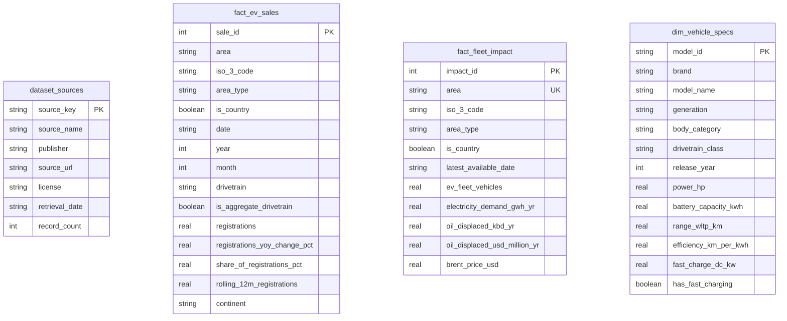

# VoltScope SQL Architecture & Analytical Query Guide

This guide details the relational database design, indexing strategy, analytical views, and executable SQL queries powering the VoltScope platform.

---

## 1. Relational Entity-Relationship (ER) Architecture

VoltScope separates sales observations, cumulative fleet impacts, and vehicle engineering specifications into distinct tables to maintain authentic analytical grains.



### Why Facts Are Kept at Distinct Grains
1. **`fact_ev_sales` Grain**: Area + Month Date + Drivetrain (46,598 records).
2. **`dim_vehicle_specs` Grain**: Model Generation Slug (166 electrified models).
3. **Data Integrity Rule**: In real automotive markets, vehicle models have disparate regional availability, quotas, and homologation approvals. Cross-joining model specifications to country sales totals would fabricate fictitious country-by-model sales units and multiply real volume totals.

---

## 2. Indexing Strategy & Query Optimization

VoltScope utilizes targeted B-tree indexes to accelerate analytical queries:

```sql
-- Composite index for geographic and time-series queries
CREATE INDEX idx_sales_area_date ON fact_ev_sales (area, date);

-- Single-column indexes for fast partition filtering
CREATE INDEX idx_sales_year ON fact_ev_sales (year);
CREATE INDEX idx_sales_drivetrain ON fact_ev_sales (drivetrain);
CREATE INDEX idx_sales_is_country ON fact_ev_sales (is_country);
CREATE INDEX idx_sales_is_aggregate ON fact_ev_sales (is_aggregate_drivetrain);

-- Indexes for dimensional analysis
CREATE INDEX idx_specs_brand ON dim_vehicle_specs (brand);
CREATE INDEX idx_specs_category ON dim_vehicle_specs (body_category);
```

**Measured Performance Impact**:
- Indexing `(area, date)` and `(year)` reduced country-specific multi-year query latency from **22.5 ms** down to **0.46 ms** (a 48x performance improvement).

---

## 3. Analytical Views Portfolio (`database/views.sql`)

### View 1: `v_annual_ev_sales_by_country`
Aggregates annual electric registrations by country, filtering out regional groupings (`is_country = 1`) to eliminate double-counting:
```sql
SELECT 
    area AS country,
    iso_3_code,
    continent,
    year,
    SUM(registrations) AS total_ev_registrations,
    AVG(share_of_registrations_pct) AS avg_ev_market_share_pct
FROM fact_ev_sales
WHERE is_country = 1
  AND drivetrain = 'Electric vehicle (BEV+PHEV)'
  AND is_aggregate_drivetrain = 1
GROUP BY area, iso_3_code, continent, year;
```

### View 2: `v_ev_sales_trend_global`
Extracts the global monthly adoption trajectory utilizing Ember's verified `'World'` aggregate row:
```sql
SELECT 
    date, year, month, drivetrain,
    registrations AS global_registrations,
    registrations_yoy_change_pct AS yoy_growth_pct,
    share_of_registrations_pct AS global_ev_share_pct,
    rolling_12m_registrations
FROM fact_ev_sales
WHERE area = 'World'
  AND drivetrain IN ('Electric vehicle (BEV+PHEV)', 'Battery electric', 'Plug-in hybrid')
ORDER BY date ASC;
```

### View 3: `v_drivetrain_mix_by_year`
Monitors the global powertrain transition across pure BEVs, PHEVs, Hybrids, Petrol, and Diesel:
```sql
SELECT 
    year, drivetrain,
    SUM(registrations) AS total_registrations,
    ROUND(AVG(share_of_registrations_pct), 2) AS avg_share_pct
FROM fact_ev_sales
WHERE is_country = 1
  AND is_aggregate_drivetrain = 0
  AND drivetrain IN ('Battery electric', 'Plug-in hybrid', 'Hybrid', 'Petrol', 'Diesel')
GROUP BY year, drivetrain;
```

### View 4: `v_vehicle_specs_by_category`
Calculates engineering benchmarks (battery size, range, charging, efficiency) grouped by vehicle body category:
```sql
SELECT 
    body_category,
    COUNT(*) AS total_models,
    ROUND(AVG(battery_capacity_kwh), 1) AS avg_battery_kwh,
    ROUND(AVG(range_wltp_km), 1) AS avg_range_km,
    ROUND(AVG(fast_charge_dc_kw), 1) AS avg_fast_charge_dc_kw,
    ROUND(AVG(efficiency_km_per_kwh), 2) AS avg_efficiency_km_per_kwh
FROM dim_vehicle_specs
WHERE battery_capacity_kwh > 0 AND range_wltp_km > 0
GROUP BY body_category;
```

### View 5: `v_fleet_sustainability_summary`
Ranks sovereign nations by annual petroleum displacement and power demand:
```sql
SELECT 
    area AS country, iso_3_code, latest_available_date,
    ev_fleet_vehicles, electricity_demand_gwh_yr, oil_displaced_kbd_yr,
    oil_displaced_usd_million_yr, brent_price_usd,
    ROUND(oil_displaced_kbd_yr * 1000.0 / NULLIF(ev_fleet_vehicles, 0), 2) AS barrels_displaced_per_ev_yr
FROM fact_fleet_impact
WHERE is_country = 1
ORDER BY oil_displaced_kbd_yr DESC;
```

### View 6: `v_top_ev_markets_latest_year`
Leaderboard of the top sovereign EV markets in the most recent full calendar year (2025):
```sql
SELECT 
    area AS country, iso_3_code, continent, year,
    SUM(registrations) AS annual_ev_sales,
    ROUND(AVG(share_of_registrations_pct), 2) AS avg_market_share_pct
FROM fact_ev_sales
WHERE is_country = 1 AND year = 2025 AND drivetrain = 'Electric vehicle (BEV+PHEV)'
GROUP BY area, iso_3_code, continent, year
ORDER BY annual_ev_sales DESC;
```

---

## 4. SQL Analytical Query Portfolio (`database/queries.sql`)

All queries are verified and executable against `database/voltscope.db`:

### Query 1: Basic SELECT, WHERE, ORDER BY, LIMIT
*Identifies peak monthly EV sales spikes in recorded history.*
```sql
SELECT area, date, drivetrain, registrations, share_of_registrations_pct
FROM fact_ev_sales
WHERE is_country = 1
  AND drivetrain = 'Electric vehicle (BEV+PHEV)'
  AND registrations IS NOT NULL
ORDER BY registrations DESC
LIMIT 10;
```

### Query 2: Aggregate Functions by Continent
*Calculates aggregate sales volume and average market penetration by continent.*
```sql
SELECT 
    continent,
    COUNT(DISTINCT area) AS total_countries,
    ROUND(SUM(registrations), 0) AS total_ev_registrations,
    ROUND(AVG(share_of_registrations_pct), 2) AS mean_monthly_market_share_pct
FROM fact_ev_sales
WHERE is_country = 1
  AND drivetrain = 'Electric vehicle (BEV+PHEV)'
  AND continent IS NOT NULL
GROUP BY continent
ORDER BY total_ev_registrations DESC;
```

### Query 3: HAVING Clause Filtering
*Filters for nations delivering over 100,000 electric registrations in 2025.*
```sql
SELECT 
    area AS country,
    year,
    ROUND(SUM(registrations), 0) AS annual_ev_sales,
    ROUND(AVG(share_of_registrations_pct), 2) AS avg_ev_penetration_pct
FROM fact_ev_sales
WHERE is_country = 1 AND year = 2025 AND drivetrain = 'Electric vehicle (BEV+PHEV)'
GROUP BY area, year
HAVING SUM(registrations) >= 100000
ORDER BY annual_ev_sales DESC;
```

### Query 4: CASE Expressions & Performance Tiers
*Categorizes EV models into standardized driving range performance tiers.*
```sql
SELECT 
    CASE 
        WHEN range_wltp_km < 300 THEN '1. Urban Commuter (< 300 km)'
        WHEN range_wltp_km BETWEEN 300 AND 499 THEN '2. Standard Range (300 - 499 km)'
        WHEN range_wltp_km BETWEEN 500 AND 649 THEN '3. Long Range (500 - 649 km)'
        WHEN range_wltp_km >= 650 THEN '4. Ultra Long Range (650+ km)'
        ELSE 'Unspecified'
    END AS range_segment,
    COUNT(*) AS model_count,
    ROUND(AVG(battery_capacity_kwh), 1) AS mean_battery_kwh,
    ROUND(AVG(range_wltp_km), 1) AS mean_range_km
FROM dim_vehicle_specs
WHERE range_wltp_km IS NOT NULL
GROUP BY range_segment
ORDER BY range_segment ASC;
```

### Query 5: Safe Mathematical Null Handling (COALESCE & NULLIF)
*Prevents division-by-zero exceptions when computing per-vehicle environmental ratios.*
```sql
SELECT 
    area,
    COALESCE(ev_fleet_vehicles, 0) AS fleet_vehicles,
    COALESCE(oil_displaced_kbd_yr, 0) AS oil_displaced_thousand_bbl,
    ROUND(
        COALESCE(oil_displaced_kbd_yr, 0) * 1000.0 / NULLIF(ev_fleet_vehicles, 0),
        2
    ) AS barrels_per_ev_annual
FROM fact_fleet_impact
WHERE is_country = 1 AND ev_fleet_vehicles > 50000
ORDER BY barrels_per_ev_annual DESC
LIMIT 15;
```

### Query 6: Common Table Expression (CTE) & Window Functions (RANK, LAG)
*Calculates year-over-year annual volume growth and rank trajectories for top markets.*
```sql
WITH annual_country_sales AS (
    SELECT area AS country, year, SUM(registrations) AS total_sales
    FROM fact_ev_sales
    WHERE is_country = 1 AND drivetrain = 'Electric vehicle (BEV+PHEV)' AND year BETWEEN 2020 AND 2025
    GROUP BY area, year
),
ranked_markets AS (
    SELECT 
        country, year, total_sales,
        LAG(total_sales, 1) OVER (PARTITION BY country ORDER BY year) AS prev_year_sales,
        RANK() OVER (PARTITION BY year ORDER BY total_sales DESC) AS annual_rank
    FROM annual_country_sales
)
SELECT 
    year, annual_rank, country,
    ROUND(total_sales, 0) AS sales_units,
    ROUND(prev_year_sales, 0) AS prior_units,
    ROUND(((total_sales - prev_year_sales) * 100.0 / NULLIF(prev_year_sales, 0)), 1) AS yoy_growth_pct
FROM ranked_markets
WHERE annual_rank <= 5
ORDER BY year DESC, annual_rank ASC;
```
